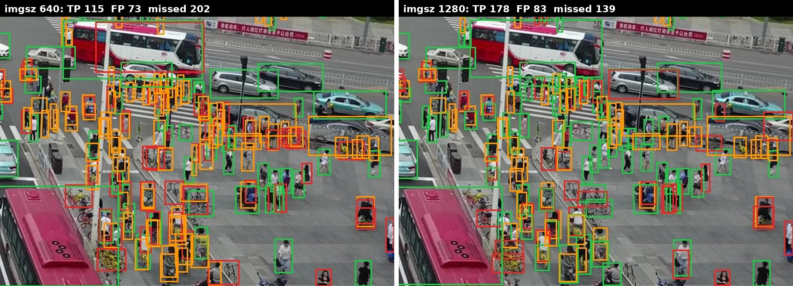

# aerial-object-detection

English · [Türkçe](README.tr.md)

Small object detection in drone images: YOLO11s trained on
[VisDrone2019-DET](https://github.com/VisDrone/VisDrone-Dataset) (10 classes, many objects under
32 pixels) at two input sizes, then run without Ultralytics through ONNX Runtime with my own
letterbox, decoding and NMS, and timed from PyTorch to TensorRT FP16.

Every mAP here is pycocotools, reproduced to the last digit by
[detection-eval](https://github.com/numanbekir/detection-eval), my evaluation code written from
scratch. That repo also explains why Ultralytics reports about 0.03–0.04 more mAP50 for the
same weights.

- **Try it in the browser:** [tanirim.com/projeler/havadan-nesne-tespiti](https://tanirim.com/projeler/havadan-nesne-tespiti)
  (the ONNX models run on your device, 640 and 1280 side by side)
- **Models:** [huggingface.co/numanbekir/visdrone-yolo11s](https://huggingface.co/numanbekir/visdrone-yolo11s)

## Results

`best.pt` of each run, selected on val. Val: 548 images, 38,759 objects. Test-dev: 1,610 images,
75,102 objects, not used for training or model selection.

| split | mAP | imgsz 640 | imgsz 1280 |
|---|---|---|---|
| val | mAP50 | 0.347 | 0.503 |
| val | mAP50-95 | 0.207 | 0.315 |
| test-dev | mAP50 | 0.288 | 0.411 |
| test-dev | mAP50-95 | 0.169 | 0.246 |

**1280 beats 640 on both splits:** +0.156 mAP50 on val, +0.123 on test-dev. Test-dev is lower
than val because its scenes are harder for this model (people and pedestrians most of all), not
because it is more crowded (46.6 objects per image vs 70.7 on val).

### AP50 per Class

| class | val 640 | val 1280 | test-dev 640 | test-dev 1280 |
|---|---|---|---|---|
| pedestrian | 0.405 | 0.620 | 0.259 | 0.418 |
| people | 0.279 | 0.476 | 0.109 | 0.252 |
| bicycle | 0.115 | 0.319 | 0.075 | 0.195 |
| car | 0.775 | 0.862 | 0.695 | 0.797 |
| van | 0.340 | 0.472 | 0.256 | 0.370 |
| truck | 0.315 | 0.470 | 0.366 | 0.506 |
| tricycle | 0.242 | 0.403 | 0.185 | 0.280 |
| awning-tricycle | 0.100 | 0.179 | 0.142 | 0.233 |
| bus | 0.489 | 0.609 | 0.518 | 0.604 |
| motor | 0.411 | 0.621 | 0.278 | 0.452 |

### AP by Object Size

AP at IoU 0.50:0.95, object area in original image pixels.

| size | val 640 | val 1280 | test-dev 640 | test-dev 1280 |
|---|---|---|---|---|
| small (< 32²) | 0.111 | 0.223 | 0.078 | 0.141 |
| medium | 0.320 | 0.436 | 0.262 | 0.361 |
| large (> 96²) | 0.443 | 0.529 | 0.408 | 0.483 |

At 640 a 1360 × 765 image is scaled down to 640 × 360, so a 20-pixel pedestrian becomes about
9 pixels. Small objects gain the most from 1280 (AP almost doubles on both splits). The cost is
speed: 3.4 ms vs 10.3 ms per image on the GPU (Ultralytics val, RTX 3060 Laptop).

### One Image



Part of val image `0000295_02400_d_0000033` (317 objects), detections with score ≥ 0.3,
IoU ≥ 0.5. Green: true positive, red: false positive, orange: missed. Counts are for the whole
image. At 1280 the model finds 63 more objects with 10 more false positives.

## Without Ultralytics: ONNX Runtime

The same weights exported to ONNX and run with ONNX Runtime. Everything around the model is this
repo's code: letterbox, decoding the raw `(1, 14, 8400)` output (`decode.py`), class-aware NMS
(`nms.py` from detection-eval). Settings as in Ultralytics: score ≥ 0.001, NMS IoU 0.7, at most
300 detections per image. mAP50:

| | Ultralytics predict | ONNX Runtime + this repo | difference |
|---|---|---|---|
| 640, val | 0.347 | 0.355 | +0.008 |
| 640, test-dev | 0.288 | 0.294 | +0.006 |
| 1280, val | 0.503 | 0.505 | +0.002 |

The whole difference comes from how the image is shrunk to the input size. Ultralytics uses
OpenCV `INTER_LINEAR` (in training too), which reads only a few source pixels for every new
pixel. This repo uses Pillow bilinear, which averages over all the source pixels it replaces.
With OpenCV `INTER_LINEAR` in the same ONNX pipeline, 640 val drops back to 0.347
(`INTER_AREA`: 0.354), so NMS and decoding match Ultralytics. At 1280 the image is only scaled
to 0.94 and the gain almost disappears. At 640 the gain is spread over all object sizes, not
only small ones.

CPU time per image (i7-11800H, ONNX Runtime): 49 ms model / 73 ms in total at 640,
264 ms / 303 ms at 1280.

## Sliced Inference (SAHI-style)

The 640 model also runs on overlapping 640 × 640 tiles at full resolution (overlap 128), plus
once on the whole image. Tile boxes are shifted back to image pixels and merged. Three merge
rules were scored from the same model runs (`slicing.py`):

- `nms`: class-aware NMS, IoU 0.7.
- `edge`: drop boxes that touch an inner tile border, then NMS. A cut object shows up whole in
  the neighbouring tile or in the whole-image pass.
- `ios`: the SAHI default (greedy merging, IoS 0.5). Every same-class box whose
  intersection-over-smaller-area is above 0.5 is merged into one box that covers them all.

VisDrone val, pycocotools, ONNX Runtime on CPU:

| | mAP50 | mAP50-95 | AP small | AP medium | AP large | ms per image |
|---|---|---|---|---|---|---|
| 640 | 0.355 | 0.211 | 0.115 | 0.326 | 0.455 | 73 |
| 640 + tiles, `nms` | 0.407 | 0.247 | 0.168 | 0.342 | 0.425 | 510–560 |
| 640 + tiles, `edge` | **0.425** | **0.259** | **0.176** | **0.358** | 0.436 | 510–560 |
| 640 + tiles, `ios` | 0.268 | 0.139 | 0.079 | 0.201 | 0.287 | 510–560 |
| 1280 | 0.505 | 0.316 | 0.227 | 0.438 | 0.537 | 303 |

(Bold: best of the tiling rows.) A val image needs 6.2 model runs on average; merging takes
14–24 ms of the time.

- **Partial boxes matter.** An object cut by a tile border gives a partial box whose IoU with
  the full box is too low for NMS to remove it. Dropping them (`edge`) improves every column
  over `nms`. car AP50 goes 0.777 → 0.833: cars are dense and often cross tile borders.
- **Large objects are still below plain 640** (0.436 vs 0.455) even without partial boxes. The
  likely cause is scale: in the tiles the model sees objects at about twice the size it was
  trained on.
- **The SAHI default collapses at mAP thresholds.** Scoring keeps boxes down to score 0.001. A
  low-score box covering a whole crowd contains every person in it (IoS 1.0), so confident
  person boxes grow into crowd-sized boxes and become false positives: people AP50 falls to
  0.061. On the first 80 images, the same IoS rule without growing the boxes scores 0.436
  (`edge`: 0.438), and with boxes below 0.25 dropped first the union merge is slightly ahead of
  NMS (0.399 vs 0.393). The rule suits on-screen detections, not low-threshold evaluation.
- **Training at 1280 is still better** on every column and faster than tiling the 640 model.
  Tiling pays off when retraining at a larger input is not possible or images are much larger
  than 1360 × 765.

## Speed

The 640 model on one GPU and one CPU, from PyTorch to TensorRT FP16. The pipeline is the same in
every row (`scripts/benchmark.py`): letterbox, model, decoding, class-aware NMS, boxes back to
image pixels. Only the model call and, in the last two rows, the letterbox change.

- **Model:** the model call alone, including copying the input to the GPU and the output back.
- **Total:** from a decoded image to the final boxes (disk reads and JPEG decoding not
  included).

Median of 100 val images after 10 warm-up images, one image at a time, score ≥ 0.25.
RTX 3060 Laptop 6 GB, i7-11800H, power mode `performance`. mAP: all of val, score ≥ 0.001,
pycocotools.

| Runtime | Letterbox | Model ms | Total ms | FPS | mAP50 | AP small |
|---|---|---|---|---|---|---|
| ONNX Runtime, CPU | Pillow, CPU | 45.4 | 52.2 | 19 | 0.3550 | 0.115 |
| PyTorch, CPU | Pillow, CPU | 42.2 | 49.2 | 20 | | |
| PyTorch, GPU FP32 | Pillow, CPU | 7.9 | 15.2 | 66 | 0.3552 | 0.115 |
| PyTorch, GPU FP16 | Pillow, CPU | 7.4 | 14.3 | 70 | 0.3546 | 0.114 |
| TensorRT FP32 | Pillow, CPU | 7.2 | 14.2 | 71 | 0.3549 | 0.115 |
| TensorRT FP16 | Pillow, CPU | 4.0 | 11.6 | 86 | 0.3548 | 0.115 |
| TensorRT FP16 | GPU bilinear | 2.5 | 5.8 | 172 | 0.3469 | 0.111 |
| TensorRT FP16 | **GPU bilinear, antialias** | **2.4** | **5.6** | **178** | **0.3539** | **0.115** |

From the first GPU row to the last: 2.7× faster, mAP50 −0.0013.

- **FP16 costs nothing in accuracy.** Every FP16 row is within 0.0006 mAP50 of FP32.
- **TensorRT and FP16 pay off together.** Each alone saves under 1 ms; together they halve the
  model time. In PyTorch, FP16 does speed up the GPU work by 1.55× (6.3 → 4.1 ms with the input
  already on the GPU), but copying the 4.9 MB FP32 input takes most of the gain back.
- **Then the letterbox is the bottleneck.** With TensorRT FP16, 7.6 of the 11.6 ms are CPU work,
  most of it the Pillow resize (about 6 ms per image). Sending the 0–255 image to the GPU and
  resizing there halves the total time and also removes the input copy from the model time.
- **The resize method shows up in mAP again.** Plain bilinear on the GPU reads only the nearest
  source pixels and gives 0.3469, the same as OpenCV `INTER_LINEAR` above. With antialias it
  averages every pixel it replaces, as Pillow does, and gets 0.3539 back at no measurable cost.
- **The power mode is part of the measurement.** In `balanced` mode the same ONNX Runtime CPU
  run takes 70 ms instead of 45 ms. The GPU rows go the other way, about 10% faster in
  `balanced`, likely because the laptop shares one power budget between CPU and GPU. All rows
  above are from one session in `performance` mode.

## How It Works

```
src/aerial_object_detection/
  decode.py        letterbox, raw YOLO output -> boxes, back to original pixels
  onnx_detector.py ONNX Runtime model + decode + NMS as one callable
  slicing.py       tile positions, shifting tile boxes back, merging (nms, edge, ios)
scripts/
  train.py         train YOLO11 on VisDrone (Ultralytics)
  predict_coco.py  Ultralytics predict on a split, detections as COCO results JSON
  inspect_onnx.py  input / output shapes and raw candidates of an ONNX model
  predict_onnx.py  ONNX Runtime + decode.py + NMS, COCO results JSON without Ultralytics
  predict_sliced.py the same on tiles + the whole image, one JSON per merge rule
  benchmark.py     time one model with ONNX Runtime, PyTorch or TensorRT, CPU or GPU letterbox
```

Scoring: `scripts/eval_coco.py` in detection-eval (pycocotools and detection-eval side by side).

## Usage

Requires [uv](https://docs.astral.sh/uv/). The dataset is not included: download and convert
VisDrone with the Ultralytics [VisDrone.yaml](https://docs.ultralytics.com/datasets/detect/visdrone/),
then put the YAML at `data/VisDrone.yaml` with `path` pointing to the dataset.

```bash
uv sync                  # detection-eval, numpy, pillow, onnxruntime + pycocotools, pytest
uv run pytest -q         # 407 tests
```

Training and Ultralytics prediction (`uv sync --group train`):

```bash
uv run python scripts/train.py --imgsz 640
uv run python scripts/train.py --imgsz 1280 --batch 4 --name visdrone_yolo11s_1280
uv run python scripts/predict_coco.py --weights runs/visdrone_yolo11s_640_baseline/weights/best.pt \
    --imgsz 640 --out runs/coco_eval/yolo11s_640_val/detections.json
```

ONNX Runtime (the export itself needs Ultralytics):

```bash
yolo export model=runs/visdrone_yolo11s_640_baseline/weights/best.pt format=onnx imgsz=640
uv run python scripts/predict_onnx.py --model runs/visdrone_yolo11s_640_baseline/weights/best.onnx \
    --out runs/coco_eval/yolo11s_640_onnx_val/detections.json
uv run python scripts/predict_sliced.py --model runs/visdrone_yolo11s_640_baseline/weights/best.onnx \
    --merge nms edge ios --out "runs/coco_eval/yolo11s_640_sliced_{merge}_val/detections.json"
```

Speed (Ultralytics environment; TensorRT engines built with `tensorrt-cu13` 10.16):

```bash
yolo export model=runs/trt_640_fp16/best.pt format=engine imgsz=640 batch=1 device=0 half=True
python scripts/benchmark.py --runtime onnx-cpu --model runs/visdrone_yolo11s_640_baseline/weights/best.onnx
python scripts/benchmark.py --runtime torch-gpu-fp16 --model runs/visdrone_yolo11s_640_baseline/weights/best.pt
python scripts/benchmark.py --runtime trt --model runs/trt_640_fp16/best.engine --preprocess gpu-aa
# mAP of a runtime: all of val, low threshold, boxes saved for eval_coco.py
python scripts/benchmark.py --runtime trt --model runs/trt_640_fp16/best.engine --preprocess gpu-aa \
    --count 548 --warmup 0 --conf 0.001 --out runs/coco_eval/yolo11s_640_trt_fp16_gpuprepaa_val/detections.json
```

For test-dev, add `--images data/VisDrone/images/test`. Scoring, from a detection-eval checkout:

```bash
uv run python scripts/eval_coco.py --data <this repo>/data/VisDrone.yaml \
    --detections <this repo>/runs/coco_eval/yolo11s_640_val/detections.json
```

Training settings: YOLO11s from COCO-pretrained weights, 50 epochs, seed 0, batch 16 at 640 and
4 at 1280 (`nbs=64` keeps the update size the same), RTX 3060 Laptop 6 GB: about 1 h 50 min and
7 h 20 min.

## Limitations

- **Ignored regions.** VisDrone marks some areas as "ignored". The Ultralytics converter drops
  them, so detections there count as false positives in every table above.
- **One seed per run.** Differences below about 0.005 mAP may be noise.

## Next

- Video and FPS.
- In the speed table: the browser (ONNX Runtime Web) and TensorRT INT8.

## License

Code: MIT. VisDrone is licensed for academic use only and is not part of this repository.
