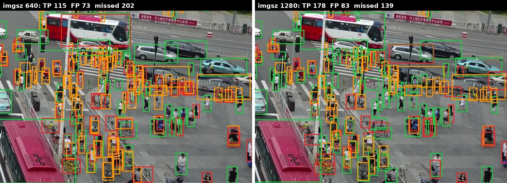
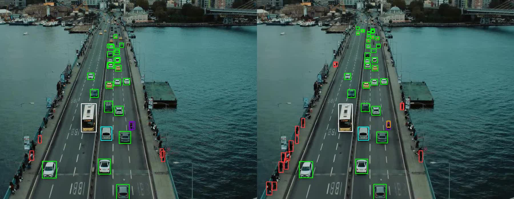

# aerial-object-detection

[English](README.md) · Türkçe

Dron görüntülerinde küçük nesne tespiti: [VisDrone2019-DET](https://github.com/VisDrone/VisDrone-Dataset)
üzerinde (10 sınıf, çoğu 32 pikselden küçük nesneler) iki giriş boyutuyla eğitilen YOLO11s.
Model daha sonra Ultralytics olmadan, ONNX Runtime ile çalıştırıldı; letterbox, kutu çözme ve
NMS bu projenin kendi kodu. Ardından hız, PyTorch'tan TensorRT FP16'ya kadar ölçüldü.

Buradaki her mAP pycocotools'la ölçüldü ve sıfırdan yazdığım değerlendirme kodu
[detection-eval](https://github.com/numanbekir/detection-eval) ile son basamağına kadar aynı çıkıyor.
O repo, Ultralytics'in aynı ağırlıklar için neden yaklaşık 0.03–0.04 daha yüksek mAP50
gösterdiğini de açıklıyor.

- **Tarayıcıda dene:** [tanirim.com/projeler/havadan-nesne-tespiti](https://tanirim.com/projeler/havadan-nesne-tespiti)
  (ONNX modelleri senin cihazında çalışıyor, 640 ve 1280 yan yana)
- **Modeller:** [huggingface.co/numanbekir/visdrone-yolo11s](https://huggingface.co/numanbekir/visdrone-yolo11s)

## Sonuçlar

Her eğitimin val'e göre seçilen `best.pt` ağırlıkları. Val: 548 görüntü, 38.759 nesne. Test-dev:
1.610 görüntü, 75.102 nesne; eğitimde ya da model seçiminde hiç kullanılmadı.

| bölüm | mAP | imgsz 640 | imgsz 1280 |
|---|---|---|---|
| val | mAP50 | 0.347 | 0.503 |
| val | mAP50-95 | 0.207 | 0.315 |
| test-dev | mAP50 | 0.288 | 0.411 |
| test-dev | mAP50-95 | 0.169 | 0.246 |

**1280 iki bölümde de 640'tan iyi:** val'de +0.156, test-dev'de +0.123 mAP50. Test-dev'in val'den
düşük olmasının sebebi sahnelerinin bu model için daha zor olması (en çok people ve pedestrian),
daha kalabalık olması değil (görüntü başına 46.6 nesne, val'de 70.7).

### Sınıf Başına AP50

| sınıf | val 640 | val 1280 | test-dev 640 | test-dev 1280 |
|---|---|---|---|---|
| pedestrian | 0.405 | 0.620 | 0.259 | 0.418 |
| people | 0.279 | 0.476 | 0.109 | 0.252 |
| bicycle | 0.115 | 0.319 | 0.075 | 0.195 |
| car | 0.775 | 0.862 | 0.695 | 0.797 |
| van | 0.340 | 0.472 | 0.256 | 0.370 |
| truck | 0.315 | 0.470 | 0.366 | 0.506 |
| tricycle | 0.242 | 0.403 | 0.185 | 0.280 |
| awning-tricycle | 0.100 | 0.179 | 0.142 | 0.233 |
| bus | 0.489 | 0.609 | 0.518 | 0.604 |
| motor | 0.411 | 0.621 | 0.278 | 0.452 |

### Nesne Boyutuna Göre AP

IoU 0.50:0.95'te AP, nesne alanı orijinal görüntü pikseliyle.

| boyut | val 640 | val 1280 | test-dev 640 | test-dev 1280 |
|---|---|---|---|---|
| küçük (< 32²) | 0.111 | 0.223 | 0.078 | 0.141 |
| orta | 0.320 | 0.436 | 0.262 | 0.361 |
| büyük (> 96²) | 0.443 | 0.529 | 0.408 | 0.483 |

640'ta 1360 × 765'lik bir görüntü 640 × 360'a küçülüyor; 20 piksellik bir yaya yaklaşık 9 piksele
iniyor. 1280'den en çok küçük nesneler kazanıyor (AP iki bölümde de neredeyse ikiye katlanıyor).
Bedeli hız: GPU'da görüntü başına 3.4 ms'ye karşı 10.3 ms (Ultralytics val, RTX 3060 Laptop).

### Tek Görüntü



Val görüntüsü `0000295_02400_d_0000033`'ün bir kısmı (317 nesne), skoru ≥ 0.3 olan tespitler,
IoU ≥ 0.5. Yeşil: doğru tespit, kırmızı: yanlış tespit, turuncu: kaçan nesne. Sayılar görüntünün
tamamı için. 1280'de model 63 nesneyi daha buluyor, 10 yanlış tespit daha yaparak.

## Ultralytics Olmadan: ONNX Runtime

Aynı ağırlıklar ONNX'e aktarılıp ONNX Runtime ile çalıştırıldı. Modelin etrafındaki her şey bu
projenin kodu: letterbox, ham `(1, 14, 8400)` çıktısını kutulara çözme (`decode.py`), sınıfa
duyarlı NMS (detection-eval'deki `nms.py`). Ayarlar Ultralytics'teki gibi: skor ≥ 0.001, NMS IoU
0.7, görüntü başına en fazla 300 tespit. mAP50:

| | Ultralytics predict | ONNX Runtime + bu proje | fark |
|---|---|---|---|
| 640, val | 0.347 | 0.355 | +0.008 |
| 640, test-dev | 0.288 | 0.294 | +0.006 |
| 1280, val | 0.503 | 0.505 | +0.002 |

Farkın tamamı, görüntünün giriş boyutuna nasıl küçültüldüğünden geliyor. Ultralytics OpenCV
`INTER_LINEAR` kullanıyor (eğitimde de); bu yöntem her yeni piksel için sadece birkaç kaynak
pikseline bakıyor. Bu proje Pillow bilinear kullanıyor; o da yerine geçtiği tüm kaynak
piksellerin ortalamasını alıyor. Aynı ONNX hattında OpenCV `INTER_LINEAR` ile 640 val yine
0.347'ye düşüyor (`INTER_AREA`: 0.354); yani NMS ve kutu çözme Ultralytics ile aynı. 1280'de
görüntü sadece 0.94'e küçüldüğü için kazanç neredeyse kayboluyor. 640'ta kazanç sadece küçük
nesnelerde değil, tüm boyutlara yayılmış.

Görüntü başına CPU süresi (i7-11800H, ONNX Runtime): 640'ta model 49 ms / toplam 73 ms,
1280'de 264 ms / 303 ms.

## Parçalı Çıkarım (SAHI Tarzı)

640 model ayrıca tam çözünürlükte, üst üste binen 640 × 640 parçalarda (örtüşme 128) ve bir kez
de görüntünün tamamında çalıştırıldı. Parçalardaki kutular görüntü piksellerine kaydırılıp
birleştirildi. Aynı model çalışmalarından üç birleştirme kuralı ölçüldü (`slicing.py`):

- `nms`: sınıfa duyarlı NMS, IoU 0.7.
- `edge`: parçanın iç kenarına değen kutuları at, sonra NMS. Kesilen nesne komşu parçada ya da
  tam görüntü geçişinde bütün görünüyor.
- `ios`: SAHI'nin varsayılanı (açgözlü birleştirme, IoS 0.5). Aynı sınıftan, kesişimi küçük
  kutunun alanına oranı 0.5'ten büyük olan her kutu, hepsini kapsayan tek kutuda birleşiyor.

VisDrone val, pycocotools, CPU'da ONNX Runtime:

| | mAP50 | mAP50-95 | AP küçük | AP orta | AP büyük | görüntü başına ms |
|---|---|---|---|---|---|---|
| 640 | 0.355 | 0.211 | 0.115 | 0.326 | 0.455 | 73 |
| 640 + parçalar, `nms` | 0.407 | 0.247 | 0.168 | 0.342 | 0.425 | 510–560 |
| 640 + parçalar, `edge` | **0.425** | **0.259** | **0.176** | **0.358** | 0.436 | 510–560 |
| 640 + parçalar, `ios` | 0.268 | 0.139 | 0.079 | 0.201 | 0.287 | 510–560 |
| 1280 | 0.505 | 0.316 | 0.227 | 0.438 | 0.537 | 303 |

(Kalın: parçalı satırların en iyisi.) Bir val görüntüsü ortalama 6.2 model çalışması istiyor;
birleştirme sürenin 14–24 ms'si.

- **Yarım kutular önemli.** Parça sınırında kesilen nesne yarım bir kutu veriyor; tam kutuyla
  IoU'su NMS'in silmesi için çok düşük. Bunları atmak (`edge`) `nms`'e göre her sütunu
  iyileştiriyor. car AP50 0.777 → 0.833: arabalar kalabalık ve sık sık parça sınırını kesiyor.
- **Büyük nesneler yarım kutular olmadan da parçalamasız 640'ın altında** (0.436'ya karşı
  0.455). Olası sebep ölçek: model parçalarda nesneleri eğitildiği boyutun yaklaşık iki katı
  büyüklükte görüyor.
- **SAHI'nin varsayılanı mAP eşiklerinde çöküyor.** Ölçümde 0.001 skora kadar kutular tutuluyor.
  Bütün bir kalabalığı kaplayan düşük skorlu bir kutu içindeki her kişiyi kapsıyor (IoS 1.0);
  emin olunan kişi kutuları kalabalık boyutuna büyüyüp yanlış pozitif oluyor: people AP50
  0.061'e düşüyor. İlk 80 görüntüde aynı IoS kuralı kutuları büyütmeden 0.436 veriyor
  (`edge`: 0.438); 0.25'in altındaki kutular önce atılınca da birleştirme NMS'in biraz önüne
  geçiyor (0.399'a karşı 0.393). Bu kural ekranda gösterilen tespitlere uygun, düşük eşikli
  ölçüme değil.
- **1280'de eğitmek hâlâ daha iyi:** her sütunda önde ve 640 modeli parçalamaktan hızlı.
  Parçalama, büyük girişle yeniden eğitim mümkün değilse ya da görüntüler 1360 × 765'ten çok
  daha büyükse işe yarıyor.

## Hız

640 model, bir GPU ve bir CPU'da, PyTorch'tan TensorRT FP16'ya. Hat her satırda aynı
(`scripts/benchmark.py`): letterbox, model, kutu çözme, sınıfa duyarlı NMS, kutuları görüntü
piksellerine geri çevirme. Sadece model çağrısı ve son iki satırda letterbox değişiyor.

- **Model:** sadece model çağrısı; girişin GPU'ya, çıkışın geri kopyalanması dahil.
- **Toplam:** çözülmüş görüntüden son kutulara kadar (diskten okuma ve JPEG çözme hariç).

10 ısınma görüntüsünden sonra 100 val görüntüsünün ortancası, görüntüler tek tek, skor ≥ 0.25.
RTX 3060 Laptop 6 GB, i7-11800H, güç modu `performance`. mAP: val'in tamamı, skor ≥ 0.001,
pycocotools.

| Çalıştırıcı | Letterbox | Model ms | Toplam ms | FPS | mAP50 | AP small |
|---|---|---|---|---|---|---|
| ONNX Runtime, CPU | Pillow, CPU | 45.4 | 52.2 | 19 | 0.3550 | 0.115 |
| PyTorch, CPU | Pillow, CPU | 42.2 | 49.2 | 20 | | |
| PyTorch, GPU FP32 | Pillow, CPU | 7.9 | 15.2 | 66 | 0.3552 | 0.115 |
| PyTorch, GPU FP16 | Pillow, CPU | 7.4 | 14.3 | 70 | 0.3546 | 0.114 |
| TensorRT FP32 | Pillow, CPU | 7.2 | 14.2 | 71 | 0.3549 | 0.115 |
| TensorRT FP16 | Pillow, CPU | 4.0 | 11.6 | 86 | 0.3548 | 0.115 |
| TensorRT FP16 | GPU bilinear | 2.5 | 5.8 | 172 | 0.3469 | 0.111 |
| TensorRT FP16 | **GPU bilinear, antialias** | **2.4** | **5.6** | **178** | **0.3539** | **0.115** |

İlk GPU satırından sonuncuya: 2.7 kat hızlı, mAP50 −0.0013.

- **FP16 doğruluktan bir şey götürmüyor.** Her FP16 satırı FP32'ye 0.0006 mAP50 yakınlıkta.
- **TensorRT ve FP16 birlikte işe yarıyor.** Tek başına her biri 1 ms'den az kazandırıyor;
  birlikte model süresini yarıya indiriyorlar. PyTorch'ta FP16 GPU hesabını gerçekten 1.55 kat
  hızlandırıyor (giriş GPU'da hazırken 6.3 → 4.1 ms), ama 4.9 MB'lık FP32 girişin kopyası
  kazancın çoğunu geri alıyor.
- **Sonra darboğaz letterbox oluyor.** TensorRT FP16'da 11.6 ms'nin 7.6'sı CPU işi, çoğu Pillow
  ile küçültme (görüntü başına yaklaşık 6 ms). 0–255 görüntüyü GPU'ya gönderip küçültmeyi orada
  yapmak toplam süreyi yarıya indiriyor ve giriş kopyasını da model süresinden çıkarıyor.
- **Küçültme yöntemi mAP'te yine görünüyor.** GPU'da düz bilinear sadece en yakın kaynak
  pikselleri okuyor ve 0.3469 veriyor; yukarıdaki OpenCV `INTER_LINEAR` ile aynı. Antialias ile
  Pillow gibi yerini aldığı bütün piksellerin ortalamasını alıyor ve ölçülebilir bir maliyet
  olmadan 0.3539'u geri getiriyor.
- **Güç modu ölçümün parçası.** `balanced` modda aynı ONNX Runtime CPU çalıştırması 45 yerine
  70 ms sürüyor. GPU satırları ters yönde, `balanced` modda yaklaşık %10 daha hızlı; muhtemelen
  laptop CPU ile GPU arasında tek bir güç bütçesi paylaştırdığı için. Yukarıdaki bütün satırlar
  `performance` modunda, tek oturumda ölçüldü.

## Video

İki model, İstanbul'da Haliç üzerindeki bir köprünün 4K, 60 FPS'lik dron videosunda
([Pexels](https://www.pexels.com/video/aerial-view-of-istanbul-s-halic-bridge-traffic-34234190/), repoda yok); TensorRT FP16,
GPU letterbox (`scripts/video.py`). 622 karenin ortancası, skor ≥ 0.25, güç modu `balanced`:

| Giriş | Kare çözme | Tespit | Çizim | Toplam | FPS | Kare başına nesne |
|---|---|---|---|---|---|---|
| 640 | 3.6 ms | 11.5 ms | 0.9 ms | 16.1 ms | **62** | 32.5 |
| 1280 | 3.7 ms | 17.5 ms | 1.2 ms | 22.4 ms | 45 | **58.8** |



- **640, 60 FPS'lik videoya yetişiyor; 1280 %81 daha fazla nesne buluyor.** Kazancın çoğu
  köprüdeki insanlar ve uzaktaki arabalar: 640 için 4K kare 6 kat küçülüyor, uzaktaki bir araba
  modele 3–4 piksel olarak ulaşıyor. İkisi de korkuluk boyunca yan yana oturan insanların çoğunu
  kaçırıyor.
- **Tespit VisDrone görüntülerine göre iki kat pahalı** (640'ta 5.6 yerine 11.5 ms). 4K kare
  24.9 MB, 1360 × 765'lik bir görüntünün 8 katı: GPU'ya kopyalamak 3.8 ms, antialias'lı küçültme
  3.2 ms (antialias'sız 1.3 ms) sürüyor. Her yeni piksel artık yaklaşık 6 × 6 kaynak pikselin
  ortalaması, yani antialias artık bedava değil.
- **4 kat piksel, 2.7 kat model süresi.** 1280 model 2.4 yerine 6.5 ms sürüyor: 640'ta GPU tam
  dolmuyor.
- **60 FPS'lik kamerada 45 FPS**, canlı bir sistemde her 4 kareden birinin atlanması demek (her
  kareyi kuyruğa koymak her saniye 0.25 sn gecikme ekler). 30 FPS'lik bir kamerada 1280 model
  kare başına yaklaşık 11 ms pay bırakarak yetişiyor.
- FPS kare çözme, tespit ve çizimi kapsıyor. Çıktı dosyasına yazma (1920 × 1080'de kare başına
  yaklaşık 10 ms) ve pencere gösterme (yaklaşık 5 ms) dahil değil.

## Nasıl Çalışıyor

```
src/aerial_object_detection/
  decode.py        letterbox, ham YOLO çıktısı -> kutular, orijinal piksellere geri dönüş
  onnx_detector.py ONNX Runtime modeli + kutu çözme + NMS tek çağrıda
  slicing.py       parça konumları, parça kutularını geri kaydırma, birleştirme (nms, edge, ios)
  runtimes.py      ONNX Runtime, PyTorch ve TensorRT tek çağrının arkasında, CPU ya da GPU letterbox
scripts/
  train.py         VisDrone'da YOLO11 eğitimi (Ultralytics)
  predict_coco.py  bir bölümde Ultralytics predict, tespitler COCO results JSON olarak
  inspect_onnx.py  bir ONNX modelinin giriş / çıkış şekilleri ve ham adayları
  predict_onnx.py  ONNX Runtime + decode.py + NMS, Ultralytics olmadan COCO results JSON
  predict_sliced.py aynısı parçalarda + tam görüntüde, her birleştirme kuralı için bir JSON
  benchmark.py     bir modelin süresi: ONNX Runtime, PyTorch ya da TensorRT, CPU ya da GPU letterbox
  video.py         bir videonun her karesinde kutular, adım başına süre, FPS
```

Ölçüm: detection-eval'deki `scripts/eval_coco.py` (pycocotools ve detection-eval yan yana).

## Kullanım

[uv](https://docs.astral.sh/uv/) gerekir. Veri seti repoda yok: VisDrone'u Ultralytics'in
[VisDrone.yaml](https://docs.ultralytics.com/datasets/detect/visdrone/) dosyasıyla indirip
dönüştür, sonra YAML'ı `path` veri setini gösterecek şekilde `data/VisDrone.yaml` olarak koy.

```bash
uv sync                  # detection-eval, numpy, pillow, onnxruntime + pycocotools, pytest
uv run pytest -q         # 407 test
```

Eğitim ve Ultralytics ile tahmin (`uv sync --group train`):

```bash
uv run python scripts/train.py --imgsz 640
uv run python scripts/train.py --imgsz 1280 --batch 4 --name visdrone_yolo11s_1280
uv run python scripts/predict_coco.py --weights runs/visdrone_yolo11s_640_baseline/weights/best.pt \
    --imgsz 640 --out runs/coco_eval/yolo11s_640_val/detections.json
```

ONNX Runtime (dışa aktarmanın kendisi Ultralytics ister):

```bash
yolo export model=runs/visdrone_yolo11s_640_baseline/weights/best.pt format=onnx imgsz=640
uv run python scripts/predict_onnx.py --model runs/visdrone_yolo11s_640_baseline/weights/best.onnx \
    --out runs/coco_eval/yolo11s_640_onnx_val/detections.json
uv run python scripts/predict_sliced.py --model runs/visdrone_yolo11s_640_baseline/weights/best.onnx \
    --merge nms edge ios --out "runs/coco_eval/yolo11s_640_sliced_{merge}_val/detections.json"
```

Hız (Ultralytics ortamı; TensorRT motorları `tensorrt-cu13` 10.16 ile kuruldu):

```bash
yolo export model=runs/trt_640_fp16/best.pt format=engine imgsz=640 batch=1 device=0 half=True
python scripts/benchmark.py --runtime onnx-cpu --model runs/visdrone_yolo11s_640_baseline/weights/best.onnx
python scripts/benchmark.py --runtime torch-gpu-fp16 --model runs/visdrone_yolo11s_640_baseline/weights/best.pt
python scripts/benchmark.py --runtime trt --model runs/trt_640_fp16/best.engine --preprocess gpu-aa
# bir çalıştırıcının mAP'i: val'in tamamı, düşük eşik, kutular eval_coco.py için kaydedilir
python scripts/benchmark.py --runtime trt --model runs/trt_640_fp16/best.engine --preprocess gpu-aa \
    --count 548 --warmup 0 --conf 0.001 --out runs/coco_eval/yolo11s_640_trt_fp16_gpuprepaa_val/detections.json
```

Video (`--show` pencere açar, `--out` mp4 yazar):

```bash
python scripts/video.py --video data/videos/bridge_4k60.mp4 --model runs/trt_640_fp16/best.engine \
    --out runs/video/bridge_640.mp4
ffmpeg -i runs/video/bridge_640.mp4 -c:v libx264 -crf 20 -pix_fmt yuv420p runs/video/bridge_640_h264.mp4
```

Test-dev için `--images data/VisDrone/images/test` ekle. Ölçüm, detection-eval klasöründen:

```bash
uv run python scripts/eval_coco.py --data <bu repo>/data/VisDrone.yaml \
    --detections <bu repo>/runs/coco_eval/yolo11s_640_val/detections.json
```

Eğitim ayarları: COCO'da önceden eğitilmiş ağırlıklardan YOLO11s, 50 epoch, seed 0; 640'ta batch
16, 1280'de 4 (`nbs=64` güncelleme boyutunu aynı tutuyor); RTX 3060 Laptop 6 GB'ta yaklaşık
1 sa 50 dk ve 7 sa 20 dk.

## Sınırlar

- **Yok sayılan bölgeler.** VisDrone bazı alanları "yok say" diye işaretliyor. Ultralytics'in
  dönüştürücüsü bunları siliyor, bu yüzden oradaki tespitler yukarıdaki tüm tablolarda yanlış
  pozitif sayılıyor.
- **Her eğitim tek seed.** Yaklaşık 0.005 mAP'den küçük farklar gürültü olabilir.

## Sırada

- Takip: kareler boyunca her nesneye tek bir numara; kutu değil araç saymak için.
- 1280 ile 4K'da 60 FPS: GPU bu kareyi işlerken bir sonraki kareyi çözmek.
- Hız tablosuna: tarayıcı (ONNX Runtime Web) ve TensorRT INT8.

## Lisans

Kod: MIT. VisDrone yalnızca akademik kullanım için lisanslı ve bu repoda yer almıyor.
